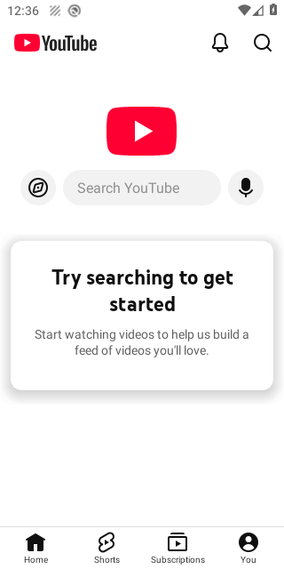

# Javo ReVanced alpha.5 verification report

The private workflow built these development APKs and bound the results below to their exact hashes. [Verification run](https://github.com/NavigatorJagdish/javo-revanced/actions/runs/42138970837)

## Verified artifacts

| Artifact | Android identity | SHA-256 |
| --- | --- | --- |
| Javo Manager 0.1.0-alpha.5 | app.javo.manager | `a8989070a976572aed876de6a0ecd197657e9cd329a41898b14c319607e621db` |
| Javo Core 0.3.13.2.250932-javo.2 | app.revanced.android.gms | `4316c1a5778e66fadd7d3d28fe689a2d74fb7c601ec36504998622cd78aaa55f` |

Manager uses a debug certificate. Core uses release runtime flags with a test certificate. Production signing and the signed production update feed require an owner-managed signing identity.

## Core changes

The non-system build removes SMS, overlay and ROM signature-spoofing permission requests. The merged APK audit confirms the restricted permissions are absent, backup is disabled and debugging is disabled. SMS retrieval and overlay-dependent features are outside this build's scope. The self-check lists declared permissions. Raw account, token, request and result logging is removed from the two modified authorization service entry points.

The earlier APK requested RECEIVE_SMS. Google documents sensitive-permission blocks for internet-sideloaded applications in supported markets. The reporter's exact warning is needed to confirm its classification. A device Play Protect verdict remains unverified. [Google guidance](https://developers.google.com/android/play-protect/warning-dev-guidance)

## Manager download changes

APKMirror transfers have connection and read timeouts, bounded redirects, browser-session cookies and an overall coroutine timeout. Transfer, merge and write stages are visible. The APKMirror browser filters known ad resources and pop-ups, opens supported suggested versions directly and highlights download controls. It recognizes both the initial download control and the final download.php link, uses the same window and reports missing controls instead of silently doing nothing. An external-browser fallback is available. Preparing, patching and writing report measured elapsed time and memory use. The native heap-property override returns a terminated property value and older Android versions skip unavailable AppCompat initialization. The default separate patcher process has a 700 MB requested heap limit, capped to one quarter of device RAM and to 700 MB on Android 10 and older, a completion timeout and process-exit recovery. The host handles split APKM merging with modules kept open until serialization finishes. Archive extraction rejects traversal and duplicate paths and bounds split count and expanded size. Byte progress supports missing size and nonzero buffer offsets. Failed replacement downloads preserve the previous APK. Logs remain exportable during patching.

## Tests from this build

- 89 host checks passed, comprising 31 Node, 13 Java security, six Java branding, 13 Java download, 12 Java browser policy and 14 Python checks.
- Manager and Core build and lint tasks passed. Module unit-test tasks can report NO-SOURCE.
- Both delivered APKs installed and launched on API29 and API35 in the workflow's Android emulators. Exact installed hashes matched and no app crashes were observed. See each runtime report for its Android version.
- Both first-party branding fixtures followed the Manager patch, rebuild, sign, install and launch path. The video fixture used the two-split merge output.
- The official ReVanced catalog loaded 294 patch definitions on Android. This CI fixture run does not execute official patches; see the separate local real-APK check below.

Android download regression checks passed.

- unknown size and nonzero buffer offset complete with exact byte count.
- stalled plugin fails and preserves the previous valid APK.
- two-split APKM serializes before resources close and preserves split resources.
- archive path traversal rejected.

The integration also transfers a 32 MiB asset APKM over a local HTTPS redirect without Content-Length, preserves its session cookie, imports the patch bundle and runs Video patching in the separate process. A deliberate child-process termination verifies prompt failure. A real WebView fixture checks ad hiding and standalone variant navigation. Core reuses the verified alpha.2 binary after matching its source tree and repeats installation and launch checks.

## Scope and remaining verification

A separate local Android 10 check patched and signed a Google-signed YouTube 20.40.45 APK using GmsCore support, Spoof video streams and Javo Video branding with a 700 MB heap. See evidence/alpha3-real-youtube.json for its exact local Manager hash and installation result; it is a different development build from this CI APK. This does not verify every official patch. A mobile-browser request and Python download succeeded, while a separate Java request returned HTTP 403. The CI fixture tests cover browser navigation, HTTPS transport, repository recovery, split merging, preparation, patching and signing against the exact delivered Manager hash. Playback, Google sign-in, Music patching, physical-device behavior and Play Protect classification remain unverified.

Core retains app.revanced.android.gms for patch compatibility. An existing installation with a different signing certificate requires a deliberate migration. The installation guide covers exporting Manager settings and its patch-signing keystore before changing installations. Lint warnings remain in the included reports.

## Package

The ZIP includes the five pinned upstream source trees, master prompt, four visual references, branding assets, 17-page static website, installation guide, APKs, branding RVP and build evidence. The website remains a static deliverable. GitHub downloads require access to the private repository.

Use apks/ for installation files, bundles/ for the optional Javo branding patch, website/ for the built site, docs/ for setup and evidence/ for test reports and screenshots. SHA256SUMS accompanies the release assets.

## Final download-button regression

The alpha.5 WebView test followed the final download.php link with a new-window target and received the native download callback on Android 10 and 15. The delivered Manager hash matched the APK installed in both CI environments. All six jobs passed. The complete release ZIP and its source inventory were independently rehashed locally; see evidence/release-alpha5.json and evidence/provenance-alpha5.json.

The separate local real YouTube check used a different development APK, applied three named patches and installed the signed output. Main navigation opened after granting the patched app its declared account-discovery permission and exempting Core from battery optimization. The observed screen is below. Feed playback and account login were not tested.

